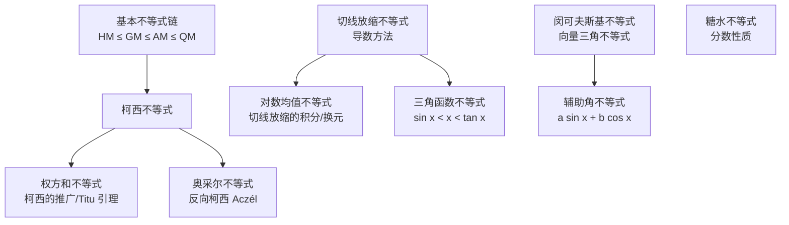

---
tags: [数学, 不等式, 讲义, 暑期课程]
科目: 高中数学
课题: 十大不等式专题
日期: 2026-08-11
课时: 120 分钟
---

# 高中数学不等式专题讲义（十大不等式）

> **适用对象**：高中（高二升高三 / 强基 / 高考压轴）
> **课时建议**：120 分钟，可拆成两节 60 分钟
> **教学主线**：代数工具（1–3、10）→ 函数工具（4、6、7）→ 几何与结构工具（5、8、9）

---

## 一、教学目标

1. 掌握十大不等式的**形式、适用条件与取等条件**；
2. 会用**导数、几何、向量**等方法理解或证明不等式；
3. 能在**最值、比较大小、证明题**中快速选择合适的工具；
4. 建立「不等式工具箱」意识：**看到结构，想到工具**。

---

## 二、课堂流程建议（120 分钟）

| 时间 | 环节 | 内容 |
| --- | --- | --- |
| 0–10 | 导入 | 复习均值不等式，引出「不等式家族」 |
| 10–35 | 第一部分 | 基本不等式链、柯西、权方和、奥采尔（代数家族） |
| 35–50 | 练习 | 对应 4 道小题（见第五节） |
| 50–80 | 第二部分 | 切线放缩、对数均值、三角函数不等式（函数家族） |
| 80–95 | 练习 | 对应 3 道小题 |
| 95–110 | 第三部分 | 闵可夫斯基、辅助角、糖水（几何/三角/数列家族） |
| 110–120 | 总结 | 取等条件、方法选择表、布置作业 |

---

## 三、不等式之间的联系（思维导图）

> 核心提醒：**均值不等式链**和**切线放缩**是主线，其余是「工具箱」里的专用工具。

---

## 四、十大不等式详解

### 1. 基本不等式链（均值不等式链）

设 $a,b>0$，则

$$
\frac{2}{\frac{1}{a}+\frac{1}{b}} \le \sqrt{ab} \le \frac{a+b}{2} \le \sqrt{\frac{a^2+b^2}{2}}
$$

即：**调和平均 H ≤ 几何平均 G ≤ 算术平均 A ≤ 平方平均（均方根）Q**。当且仅当 $a=b$ 时等号同时成立。

$n$ 元形式：设 $a_1,\dots,a_n>0$，则

$$
\frac{n}{\sum_{i=1}^{n}\frac{1}{a_i}} \le \sqrt[n]{a_1a_2\cdots a_n} \le \frac{\sum_{i=1}^{n}a_i}{n} \le \sqrt{\frac{\sum_{i=1}^{n}a_i^2}{n}}
$$

- **证明思路**：核心只需证 G ≤ A（取对数后用凹凸性，或用数学归纳法）；其余由「对 $\frac1a,\frac1b$ 用 G ≤ A」「对 $a^2,b^2$ 用 G ≤ A」推出。
- **使用口诀**：一正、二定、三相等（各项为正；和为定值求积最大，或积为定值求和最小；验证取等时变量可取得）。
- **常考模型**：$x+\frac1x\ge2$；$\frac ab+\frac ba\ge2$；「1 的代换」凑定值。

**例题**：已知 $x,y>0$，$x+2y=1$，求 $\frac1x+\frac1y$ 的最小值。

**解**：
$$
\frac1x+\frac1y=(x+2y)\left(\frac1x+\frac1y\right)=3+\frac{x}{y}+\frac{2y}{x}\ge 3+2\sqrt{\frac{x}{y}\cdot\frac{2y}{x}}=3+2\sqrt2
$$
当且仅当 $\frac{x}{y}=\frac{2y}{x}$，即 $x=\sqrt2\,y$，与 $x+2y=1$ 联立可取（$y=\frac{1}{2+\sqrt2}$）时取等。**最小值为 $3+2\sqrt2$。**

- **易错点**：① 忘记验证取等；② 用错方向（和定求积最大 vs 积定求和最小）；③ 各项必须为正。

---

### 2. 柯西不等式（Cauchy–Schwarz）

设 $a_i,b_i$ 为实数，则

$$
\left(\sum_{i=1}^{n}a_i^2\right)\left(\sum_{i=1}^{n}b_i^2\right)\ge\left(\sum_{i=1}^{n}a_ib_i\right)^2
$$

当且仅当 $a_1:b_1=a_2:b_2=\cdots=a_n:b_n$（即存在常数 $\lambda$ 使 $a_i=\lambda b_i$）时取等。

**二维形式**（最常考）：

$$
(a^2+b^2)(c^2+d^2)\ge(ac+bd)^2
$$

- **向量形式**：$|\vec u\cdot\vec v|\le|\vec u||\vec v|$；
- **三角形式**：$\sqrt{a^2+b^2}+\sqrt{c^2+d^2}\ge\sqrt{(a+c)^2+(b+d)^2}$（与闵可夫斯基相通）。

- **证明思路**：构造二次函数 $f(t)=\sum(a_it-b_i)^2\ge0$，其判别式 $\Delta\le0$；或用向量内积。
- **用途**：已知「平方和」求「一次式」最值；证明；解不等式。

**例题**：已知 $x,y\ge0$ 且 $x^2+y^2=1$，求 $2x+3y$ 的最大值。

**解**：由柯西 $(2x+3y)^2\le(2^2+3^2)(x^2+y^2)=13$，故 $2x+3y\le\sqrt{13}$。取等条件 $\frac{x}{2}=\frac{y}{3}$ 且 $x^2+y^2=1$，可取得。**最大值为 $\sqrt{13}$。**

---

### 3. 权方和不等式（Bergström / Titu 引理）

设 $x_i\ge0,\ y_i>0$，实数 $m\ge0$，则

$$
\sum_{i=1}^{n}\frac{x_i^{m+1}}{y_i^{m}}\ge\frac{\left(\sum_{i=1}^{n}x_i\right)^{m+1}}{\left(\sum_{i=1}^{n}y_i\right)^{m}}
$$

当且仅当 $\frac{x_1}{y_1}=\frac{x_2}{y_2}=\cdots=\frac{x_n}{y_n}$ 时取等。

**最常用：$m=1$（Titu 引理）**

$$
\frac{a_1^2}{b_1}+\frac{a_2^2}{b_2}+\cdots+\frac{a_n^2}{b_n}\ge\frac{(a_1+\cdots+a_n)^2}{b_1+\cdots+b_n}
$$

二维形式：$\frac{a^2}{x}+\frac{b^2}{y}\ge\frac{(a+b)^2}{x+y}$。

- **证明思路**：$m=1$ 时是柯西的直接推论（把 $\frac{a_i^2}{b_i}$ 写成 $\left(\frac{a_i}{\sqrt{b_i}}\right)^2$）；一般 $m$ 由琴生不等式或赫尔德不等式得到。
- **用途**：分式最值的利器——「分母为一次式、分子为二次式」的结构直接套用。

**例题**：已知 $x,y>0$，$x+y=1$，求 $\frac1x+\frac4y$ 的最小值。

**解**：
$$
\frac1x+\frac4y=\frac{1^2}{x}+\frac{2^2}{y}\ge\frac{(1+2)^2}{x+y}=9
$$
当且仅当 $\frac{1}{x}=\frac{2}{y}$，即 $y=2x$，$x=\frac13,y=\frac23$ 时取等。**最小值为 $9$。**

---

### 4. 切线放缩不等式（导数放缩）

**思想**：对可导函数 $f(x)$，用它在特殊点处的**切线**（或割线）来夹逼、控制函数值。

**常用结论（要求会推导、记住取等点）**：

| 结论 | 取等点 |
| --- | --- |
| $e^x\ge x+1$ | $x=0$ |
| $\ln x\le x-1$ | $x=1$ |
| $e^x\ge ex$ | $x=1$（由 1 换元） |
| $\ln x\le \frac{x}{e}$ | $x=e$ |
| $\ln x\ge1-\frac1x$ | $x=1$（由 $\ln x\le x-1$ 中 $x\to\frac1x$） |
| 加强：$e^x\ge1+x+\frac{x^2}{2}\ (x\ge0)$ | $x=0$ |

**方法步骤**：
1. 确定函数与切线点（常取 $0,1,e$ 等特殊点）；
2. 判断**凹凸性**（二阶导符号）：凸函数图像在切线上方，凹函数图像在切线下方；
3. 构造 $F(x)=f(x)-$ 切线，用导数证明 $F(x)\ge0$。

- **用途**：证明含 $e^x,\ln x$ 的不等式；比较大小；分离参数后求范围。

**例题**：证明当 $x>0$ 时，$\ln x\le x-1$。

**解**：设 $F(x)=\ln x-(x-1)=\ln x-x+1$，则 $F'(x)=\frac1x-1$。故 $F$ 在 $(0,1)$ 上增、在 $(1,+\infty)$ 上减，$F(x)\le F(1)=0$，即 $\ln x\le x-1$，当且仅当 $x=1$ 取等。$\blacksquare$

- **易错点**：放缩方向搞反（要判断凹凸性）；取等点与题目条件是否兼容。

---

### 5. 闵可夫斯基不等式（Minkowski）

**$p=2$ 形式（最常用）**：

$$
\sqrt{\sum_{i=1}^{n}(a_i+b_i)^2}\le\sqrt{\sum_{i=1}^{n}a_i^2}+\sqrt{\sum_{i=1}^{n}b_i^2}
$$

**二维形式**：

$$
\sqrt{a^2+b^2}+\sqrt{c^2+d^2}\ge\sqrt{(a+c)^2+(b+d)^2}
$$

一般形式（$p\ge1$）：$\|u+v\|_p\le\|u\|_p+\|v\|_p$。

- **证明思路**：平方展开后用柯西处理交叉项：
  $$
  \left(\sqrt{a^2+b^2}+\sqrt{c^2+d^2}\right)^2=a^2+b^2+c^2+d^2+2\sqrt{(a^2+b^2)(c^2+d^2)}\ge(a+c)^2+(b+d)^2
  $$
- **几何意义**：向量模长的三角不等式（折线长度 ≥ 直线长度）。
- **用途**：多个「根号下平方和」之和的最小值问题（距离和问题）。

**例题**：求 $f(x)=\sqrt{x^2+1}+\sqrt{(x-3)^2+4}$ 的最小值。

**解**：记 $u=(x,1),\ v=(3-x,2)$，则
$$
f(x)=\sqrt{x^2+1}+\sqrt{(3-x)^2+2^2}\ge\sqrt{(x+3-x)^2+(1+2)^2}=3\sqrt2
$$
当且仅当 $u\parallel v$，即 $\frac{x}{1}=\frac{3-x}{2}\Rightarrow x=1$ 时取等。**最小值为 $3\sqrt2$。**

---

### 6. 对数均值不等式（ALG）

设 $a>b>0$，记对数平均 $L(a,b)=\dfrac{a-b}{\ln a-\ln b}$，则

$$
\sqrt{ab}<\frac{a-b}{\ln a-\ln b}<\frac{a+b}{2}
$$

即 **几何平均 < 对数平均 < 算术平均**。

- **证明思路（比值换元）**：
  - 右边：令 $t=\frac{a}{b}>1$，原式 $\Leftrightarrow \ln t>\frac{2(t-1)}{t+1}$，构造 $g(t)=\ln t-\frac{2(t-1)}{t+1}$，$g'(t)=\frac{(t-1)^2}{t(t+1)^2}\ge0$，$g(t)>g(1)=0$；
  - 左边：令 $t=\sqrt{\frac{a}{b}}>1$，原式 $\Leftrightarrow 2\ln t<t-\frac1t$，构造 $h(t)=t-\frac1t-2\ln t$，$h'(t)=\frac{(t-1)^2}{t^2}\ge0$，$h(t)>h(1)=0$。
  - 也可用切线放缩 $\ln x\le x-1$、$\ln x\ge1-\frac1x$ 快速获得部分结论。
- **用途**：导数双变量问题、**极值点偏移**、含 $\ln$ 的不等式证明。
- **常见考法**：已知 $x_1\ne x_2$ 且 $x_1,x_2>0$，比较 $\frac{x_1+x_2}{2}$、$\sqrt{x_1x_2}$、$\frac{x_1-x_2}{\ln x_1-\ln x_2}$ 的大小——直接套用本不等式。

**例题**：证明：对任意 $a>b>0$，有 $\sqrt{ab}<\dfrac{a-b}{\ln a-\ln b}$。

**解**：令 $t=\sqrt{\frac ab}>1$，则原式 $\Leftrightarrow 2\ln t<t-\frac1t$。设 $h(t)=t-\frac1t-2\ln t$，则 $h'(t)=1+\frac1{t^2}-\frac2t=\frac{(t-1)^2}{t^2}\ge0$，故 $h$ 在 $(1,+\infty)$ 上增，$h(t)>h(1)=0$，原不等式成立。$\blacksquare$

---

### 7. 三角函数不等式

常用结论（角度一律用**弧度制**）：

1. 当 $0<x<\frac{\pi}{2}$ 时，$\sin x<x<\tan x$；
2. 对任意实数 $x$，$|\sin x|\le|x|$；
3. 当 $x>0$ 时，$\cos x>1-\frac{x^2}{2}$；
4. 当 $0\le x\le\frac{\pi}{2}$ 时，$\sin x\ge\frac{2}{\pi}x$（正弦在 $[0,\pi/2]$ 上为凹函数，图像在弦上方）。

- **证明思路**：$\sin x<x<\tan x$ 用**单位圆**中扇形面积与三角形面积比较；其余构造 $F(x)=x-\sin x$ 等用导数证明。
- **用途**：比较大小（如 $\sin1$ 与 $1$、$\tan0.5$ 与 $0.5$）、导数压轴中的三角放缩。

**例题**：比较 $\sin1$、$1$、$\tan1$ 的大小。

**解**：因 $0<1<\frac{\pi}{2}$，由 $\sin x<x<\tan x$ 取 $x=1$ 得 $\sin1<1<\tan1$。

---

### 8. 辅助角不等式

**辅助角公式**：对任意不全为 0 的实数 $a,b$，

$$
a\sin x+b\cos x=\sqrt{a^2+b^2}\,\sin(x+\varphi),\qquad \varphi=\arg(a+bi)
$$

由此得**辅助角不等式**：

$$
-\sqrt{a^2+b^2}\le a\sin x+b\cos x\le\sqrt{a^2+b^2}
$$

当且仅当 $\sin(x+\varphi)=\pm1$ 时取等。

- **证明思路**：由 $|\sin t|\le1$ 直接得到；也可看作向量 $(a,b)$ 与 $(\sin x,\cos x)$ 的内积，用柯西不等式：
  $$
  a\sin x+b\cos x\le\sqrt{a^2+b^2}\cdot\sqrt{\sin^2x+\cos^2x}=\sqrt{a^2+b^2}
  $$
- **用途**：求 $y=a\sin x+b\cos x$（含混合型、二次型）的值域与最值。

**例题**：求 $y=\sin x+\sqrt3\cos x$ 的最大值。

**解**：$y=2\sin\left(x+\frac{\pi}{3}\right)$，故最大值为 $2$，当 $x+\frac{\pi}{3}=\frac{\pi}{2}+2k\pi$，即 $x=\frac{\pi}{6}+2k\pi$ 时取等。

---

### 9. 糖水不等式

设 $0<b<a$，$m>0$，则

$$
\frac{b}{a}<\frac{b+m}{a+m}
$$

即「往糖水中加糖，糖水更甜」（浓度变大）。

- **证明（作差法）**：
  $$
  \frac{b+m}{a+m}-\frac{b}{a}=\frac{m(a-b)}{a(a+m)}>0
  $$
- **推广**：$a>b>0$ 时，同加正数 $m$ 后分数值变大；分子分母同时加上同一个正量，分数向 1 靠拢。
- **用途**：比较分数大小、判断数列单调性（如 $\frac{2010}{2011}$ 与 $\frac{2011}{2012}$）、放缩。

**例题**：比较 $\frac{2010}{2011}$ 与 $\frac{2011}{2012}$ 的大小。

**解**：由 $0<2010<2011$，加 $m=1$ 得 $\frac{2010}{2011}<\frac{2010+1}{2011+1}=\frac{2011}{2012}$。

---

### 10. 奥采尔不等式（Aczél 不等式 / 反向柯西）

设实数 $a,b$ 与 $a_i,b_i\ (i=1,\dots,n)$ 满足 $a^2-\sum_{i=1}^{n}a_i^2>0$ 或 $b^2-\sum_{i=1}^{n}b_i^2>0$，则

$$
\left(a^2-\sum_{i=1}^{n}a_i^2\right)\left(b^2-\sum_{i=1}^{n}b_i^2\right)\le\left(ab-\sum_{i=1}^{n}a_ib_i\right)^2
$$

当且仅当数列 $\{a,a_1,\dots,a_n\}$ 与 $\{b,b_1,\dots,b_n\}$ 成比例时取等。

**二维形式**（最常考）：若 $a^2>b^2$，$c^2>d^2$，则

$$
(a^2-b^2)(c^2-d^2)\le(ac-bd)^2
$$

- **证明思路**：与柯西对比——柯西是「平方和」，奥采尔是「平方差」，本质是**反向柯西**；可通过复化技巧或构造二次函数证明。
- **用途**：处理含 $a^2-b^2$ 型结构的约束最值问题（双曲线型约束）。

**例题**：已知 $x^2-y^2=4$（$x>y\ge0$），求 $3x-2y$ 的最小值。

**解**：由奥采尔不等式
$$
(x^2-y^2)(3^2-2^2)\le(3x-2y)^2\Rightarrow 4\times5\le(3x-2y)^2
$$
故 $3x-2y\ge2\sqrt5$。取等条件 $\frac{x}{3}=\frac{y}{2}$，联立 $x^2-y^2=4$ 得 $x=\frac{6}{\sqrt5},\ y=\frac{4}{\sqrt5}$，可取得。**最小值为 $2\sqrt5$。**

---

## 五、课堂练习（学生独立完成，10 分钟）

1. 已知 $a,b>0$，$a+b=1$，求 $ab$ 的最大值。  —— 答案：$\frac14$
2. 已知 $x,y>0$，$x+y=2$，求 $\frac1x+\frac1y$ 的最小值。  —— 答案：$2$
3. 求 $y=3\sin x+4\cos x$ 的最大值。  —— 答案：$5$
4. 用糖水不等式比较 $\frac58$ 与 $\frac7{10}$ 的大小。  —— 答案：$\frac58<\frac7{10}$
5. 证明：当 $x>0$ 时，$e^x\ge x+1$。  —— 构造 $F(x)=e^x-x-1$，$F'(x)=e^x-1$，$F(x)\ge F(0)=0$
6. 已知 $a^2+b^2=1$，求 $a+2b$ 的最大值。  —— 答案：$\sqrt5$

---

## 六、作业

1. 用**两种方法**（柯西、权方和）证明：对 $x,y>0$，$\frac1x+\frac1y\ge\frac4{x+y}$；
2. 教材/真题中分别找 1 道「已知和求积最值」「已知积求和最值」的题目并完成；
3. 选做：用切线放缩（二阶切线）探索 $x>0$ 时 $e^x>\frac12x^2+x+1$ 是否成立并证明；
4. 预习：导数与不等式综合（极值点偏移第一讲）。

---

## 七、教学要点提示（老师用）

- 反复强调「**一正、二定、三相等**」与「**取等条件**」是三大灵魂；
- 建议把「均值不等式链」「切线放缩」作为**主线**反复训练，其余作为**工具库**按需调用；
- 奥采尔、闵可夫斯基、对数均值属**拓展内容**，根据学生基础决定详略；
- 每讲完一个不等式，让学生**口述取等条件**，巩固记忆；
- 若时间不足，优先保证：基本不等式链 → 柯西 → 权方和 → 切线放缩 → 糖水。

---

## 附录：十大不等式速查表

| # | 名称 | 核心结论（二维形式） | 取等条件 |
| --- | --- | --- | --- |
| 1 | 基本不等式链 | $\frac{2}{1/a+1/b}\le\sqrt{ab}\le\frac{a+b}{2}\le\sqrt{\frac{a^2+b^2}{2}}$ | $a=b$ |
| 2 | 柯西 | $(a^2+b^2)(c^2+d^2)\ge(ac+bd)^2$ | $a:b=c:d$ |
| 3 | 权方和 | $\frac{a^2}{x}+\frac{b^2}{y}\ge\frac{(a+b)^2}{x+y}$ | $\frac ax=\frac by$ |
| 4 | 切线放缩 | $e^x\ge x+1$，$\ln x\le x-1$ | $x=0$，$x=1$ |
| 5 | 闵可夫斯基 | $\sqrt{a^2+b^2}+\sqrt{c^2+d^2}\ge\sqrt{(a+c)^2+(b+d)^2}$ | 向量共线同向 |
| 6 | 对数均值 | $\sqrt{ab}<\frac{a-b}{\ln a-\ln b}<\frac{a+b}{2}$ | $a=b$（取不到） |
| 7 | 三角函数 | $\sin x<x<\tan x\ (0<x<\frac\pi2)$ | $x\to0$ |
| 8 | 辅助角 | $-\sqrt{a^2+b^2}\le a\sin x+b\cos x\le\sqrt{a^2+b^2}$ | $\sin(x+\varphi)=\pm1$ |
| 9 | 糖水 | $0<b<a\Rightarrow\frac ba<\frac{b+m}{a+m}$ | $m\to0$ |
| 10 | 奥采尔（反向柯西） | $(a^2-b^2)(c^2-d^2)\le(ac-bd)^2$ | $a:c=b:d$ |
